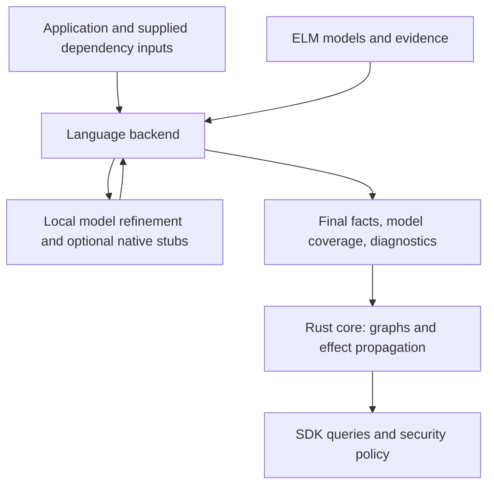
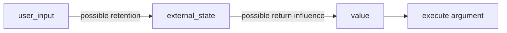

# 0003: External Library Model (ELM)

## 1. Context

The analyzer must produce useful application facts when dependencies are incomplete. Customers can supply source, declarations, or compiled artifacts without a target build. Private libraries and their dependencies can remain unavailable.

Two gaps require separate treatment:

1. **Missing API structure.** The resolver lacks a module, type, member, signature, or inheritance relationship.
2. **Missing behavior.** A call resolves, but its implementation is unavailable or excluded from analysis.

A generated declaration gives the resolver a description of the external function or method used at a call site. It does not establish what the call returns, changes, retains, or invokes. Ignoring these effects can remove application flows. Broad approximations retain more possibilities and introduce false positives.

This ADR proposes an **External Library Model (ELM)** shared across backends. It is an RFC, with open questions and illustrative pseudocode. It does not authorize implementation or establish soundness across languages.

### 1.1 Relationship to Averroes

Averroes generates Java replacement bytecode for application call-graph analysis. Its separate-compilation assumption constrains possible library behavior. The original algorithm reads application references and metadata from referenced library classes, including their ancestors. It does not require analysis of library method bodies.

Its `libraryPointsTo` pool collects objects available to the library. Synthetic methods use that pool for returns, callbacks, allocations, and other effects. The original implementation requires changes for flow-sensitive analysis. Its constant primitive returns do not preserve arbitrary value dependencies. See [Averroes, sections 2–3](https://plg2.cs.uwaterloo.ca/~olhotak/pubs/ecoop13.pdf).

ELM proposes a similar pool, named `external_state`, with separate reference and value-flow information. ELM also addresses missing API metadata and language-specific adapters. These additions require their own assumptions and validation.

JPhantom complements missing Java hierarchies from bytecode constraints. Verifier consistency does not establish the actual library hierarchy or its behavior. See [JPhantom](https://yanniss.github.io/jphantom-oopsla13.pdf).

CodeQL provides another relevant design: explicit library summaries for value flow, taint propagation, callbacks, sources, sinks, and barriers. These are distinct modeling concerns. See [CodeQL library models](https://codeql.github.com/docs/codeql-language-guides/customizing-library-models-for-javascript/).

## 2. Proposed decision

If this RFC is accepted, we will introduce ELM as a shared contract for external structure, effects, evidence, and coverage. Language backends will interpret language semantics. The Rust core will consume agreed facts and construct graphs.

| Proposed direction | Still open |
| --- | --- |
| Separate API structure from behavioral effects. | Exact model schema and facts IR records. |
| Preserve evidence and uncertainty per assertion. | Model precedence, conflict handling, and completeness rules. |
| Support an Averroes-style fallback for unknown behavior. | Default policy, state scope, and supported assumptions. |
| Permit native stub adapters where they improve resolution. | First adapters and engine compatibility. |
| Refine models only when new constraints justify another pass. | Budgets, heap bounds, and incremental invalidation. |
| Expose unsupported effects and incomplete analysis. | Consumer schema and security-query behavior. |

### 2.1 Model contents

The proposed model contains four parts:

| Part | Contents |
| --- | --- |
| Identity and structure | Import identity, symbols, signatures, type constraints, and known relationships. Dependency ownership and version can remain unknown. |
| Effects | Possible value transfers, aliases, reads, writes, retention, allocations, callbacks, exceptions, and external interactions. |
| Evidence | Input locations, supplied declarations, model origin, derivation dependencies, model revision, and applicable assumptions. |
| Coverage | Supported effect dimensions, unresolved constraints, conflicts, unsupported features, and resource limits. |

An observation constrains the application use that produced it. For example, a call with a string argument does not prove a string-only library signature. A method used on a returned object does not establish its actual named class.

Supplied definitions take precedence over inferred placeholders for matching identities and versions. A supplied signature alone does not replace an unknown behavioral model. Conflicting evidence remains visible.

Completeness applies separately to each effect dimension and its assumptions. A complete return model can coexist with unknown mutation or callback behavior. Model origin or reviewer trust alone does not establish completeness.

### 2.2 Architecture boundary



The loop remains inside the backend before it emits the final facts stream. It does not create a core-to-backend resolver protocol.

Language-specific oracles remain in their backends. An oracle can consume an adapted ELM model and emit the relations it computes. The core preserves those relations.

For a backend without a suitable oracle, this proposal permits the core to interpret language-neutral effect constraints. That requires sufficient alias and target facts. Unsupported constraints remain explicit.

Each effect needs an execution owner: the backend oracle or the core. Coverage must identify effects already applied by an oracle. Edge deduplication alone cannot prevent duplicate allocations or inconsistent callback modeling.

This extends the input contract described in [ADR 0002](0002-facts-ir.md). The current contract has closed record kinds and provenance vocabularies. Its `SummaryToken` identifies an abstract object. It does not encode an effect transfer.

Before implementation, the facts IR needs typed representations for effects, coverage, model identity, and attribution. ELM effect summaries differ from graph `summary` edges produced by the core. This draft does not add undocumented fields or opaque payloads to the current IR.

Model declarations must precede references to them in the facts stream. Stable model identities must not depend on temporary stub paths. Consumer-visible attribution also requires a schema decision.

### 2.3 Discovery and optional native stubs

The backend first collects imports, declarations, call sites, and constraints from application usage. It then distinguishes unresolved references, ambiguous candidates, and resolver failures.

An unresolved reference is not automatically external. Import bindings or other evidence must connect it to an external identity. Otherwise, the backend retains an unresolved application site.

Discovery also includes resolved external calls whose behavior remains unavailable. A missing-symbol pass alone cannot identify every required effect model.

| Language | Candidate representation | Important limit |
| --- | --- | --- |
| Python | Internal symbolic model, with optional `.pyi` overlay for Jedi. | Empty inference results, ambiguity, and exceptions require separate treatment. |
| TypeScript / JavaScript | Internal model, compiler-host declarations, or generated `.d.ts` files. | Successful declaration resolution does not establish effects. Broad `any` declarations can hide remaining gaps. |
| Java | Internal hierarchy constraints or generated bytecode for a native engine. | Bytecode descriptors constrain members. Missing ancestors still affect dispatch and callbacks. |
| Go | Supplied type information or synthetic packages through `go/types.Importer`. | Method sets, interfaces, generics, build constraints, and cgo need backend rules. |
| Other backends | An adapter to the same concepts where the frontend supports them. | Preprocessing, templates, macros, native interfaces, and runtime features need separate evaluation. |

Jedi returns a list of inferred definitions. An empty result is a normal unresolved outcome, not a dedicated missing-library exception. See [Jedi API](https://jedi.readthedocs.io/en/stable/docs/api.html#jedi.Script.infer).

Declaration files describe TypeScript module APIs. Go exposes imported package types through its importer interface. These provide adapter mechanisms, without requiring one common stub-file format. See [TypeScript declarations](https://www.typescriptlang.org/docs/handbook/declaration-files/templates/module-d-ts.html) and [Go importer](https://pkg.go.dev/go/types#Importer).

Generated stubs remain isolated from customer source and supplied dependencies. The adapter must prevent them from silently shadowing real definitions. Stub files are optional reusable projections of ELM structure. Effects remain in the model or a compatible analysis representation.

### 2.4 Pseudocode: discover and refine structure

This sketch describes a backend-local worklist. The helper names are conceptual, not proposed public APIs.

Fixed-point iteration handles feedback: new information can change the result of a rule that already ran.

**The structural fixed point is induced by feedback between model construction and resolution.** A changed model can enable resolution that exposes more application constraints. Those constraints can change the model again:

```text
new usage constraint -> changed ELM structure -> affected resolution
                    -> newly exposed usage constraint -> ...
```

For example, an external factory returns an unknown object used in `factory().session().send(payload)`. A symbolic return object can enable resolution of `session`. Its return object can then expose the constraint on `send`. These observations establish required structure under stated assumptions, not the actual classes or behavior.

If the initial scan already collects the full chain, one constraint solve can suffice. Another resolver pass requires a semantic model change that can affect resolution. Missing dependencies alone do not justify repeated passes.

```text
recover_structure(application, supplied_inputs, adapter, budget):
    evidence = collect_original_observations(application, supplied_inputs)
    model = solve_constraints(evidence)
    work = affected_scopes(application, model)

    while work is not empty:
        if budget.exhausted():
            return snapshot(model, status="partial", remaining=work)

        scope = work.pop()
        view = adapter.overlay(supplied_inputs, model)
        result = adapter.resolve(scope, view)
        record_outcomes(result.unresolved, result.ambiguous, result.errors)

        constraints = derive_constraints(result, application)
        constraints = attach_derivation_roots(constraints, evidence, model)
        delta = evidence.add_new_normalized_constraints(constraints)

        if delta is not empty:
            previous = model
            model = solve_constraints(evidence)
            preserve_conflicts_and_unknowns(model)
            work.add(scopes_affected_by(previous, model))

    return snapshot(model, status="stable")
```

Evidence accumulates, while candidate interpretations are recomputed. A model-derived result retains its original assumptions. Resolving a generated declaration does not independently confirm that declaration.

Derived constraints remain conditional on their assumptions. An invalidated hypothesis cannot leave unconditional facts behind. If precise dependency tracking is unavailable, the adapter marks the affected resolver result as model-assisted.

The solver compares normalized constraints and model meaning. Regenerated identifiers or repeated diagnostics do not count as progress. Real-input changes invalidate affected derived results and cached snapshots.

The structural loop is stable after all affected scopes have been processed without further semantic model changes. All applicable discovery rules must then yield no new normalized constraints. Unresolved references and conflicts can remain in this stable result.

Finite symbol abstractions, bounded access paths, and explicit widening can support termination. Widening merges possibilities into an unknown summary. It must not silently discard them. A budget stop produces partial coverage, not a fixed-point claim.

Supplied declarations or bytecode can remove the need for structural refinement. Language typing alone does not require or eliminate iteration.

Structure refinement and graph propagation have separate convergence conditions. Neither process discovers hidden library behavior from repeated resolution alone.

### 2.5 Effects and their endpoints

An effect connects abstract endpoints. Endpoints include arguments, the receiver, returns, exceptions, fields, array elements, accessible globals, retained state, and callback ports.

The prefix `may_` denotes an analysis possibility. It does not assert that the effect occurs on every execution.

| Illustrative effect | Meaning |
| --- | --- |
| `may_flow(input, output, kind)` | A possible transfer. `kind` distinguishes preserved values from derived value influence. |
| `may_alias(input, output)` | Both endpoints can refer to the same object. |
| `may_read(location)` | The call can read the abstract location. |
| `may_write(location, values)` | The call can store one of these possible values at the location. |
| `may_retain(value, state)` | The library can preserve the value beyond this call. |
| `may_allocate(type, output)` | The call can produce an abstract object of the indicated type. Unknown types remain explicit. |
| `may_invoke(callback, arguments, result, exception)` | The library can invoke an accessible callable and exchange values with it. |
| `may_throw(value)` | The call can complete exceptionally with the indicated value. |
| `may_read_external(output)` | The output can contain data from an external origin. |
| `may_expose(input)` | The library can pass the input outside the modeled application boundary. |

Value influence and object identity require distinct rules. An integer-to-string conversion can preserve information without preserving the input value or object identity. Type incompatibility alone cannot exclude derived influence.

A possible write uses a weak update: the analysis retains old contents and adds possible new contents. Replacement requires stronger evidence about the location and execution. Language rules determine writable locations and parameter-passing behavior.

### 2.6 The `external_state` pool

`external_state` represents values and objects available to unanalyzed external code. It is an abstract memory region with persistent identity across calls in its scope.

The pool acts as a collection sink for escaping information. **It is not automatically a security sink.** A security sink describes a specific sensitive operation or policy boundary.

The proposed pool has separate components:

```text
external_state[scope]:
    references    # abstract object identities and aliases
    values        # abstract values and value-influence origins
    callbacks     # accessible callable identities, including retained callbacks
```

Reachable fields, arrays, and permitted globals supply further values and references. Callback returns and exceptions can also enter the pool. Returned references can alias existing objects or represent new external objects.

The scope is an open design choice. A single application-wide pool is a useful conservative baseline for evaluation. It merges unrelated library operations and can create many false flows.

Splitting the pool by package, receiver, or context can improve precision. Such partitions require rules for shared globals, cross-library calls, aliases, and escaped objects. Package names alone do not establish isolation.

The baseline sketch is flow-insensitive. It can connect an earlier return to an argument from a later call. That path records a possible dependency in the abstraction, not a feasible execution trace.

### 2.7 Worked example: retention across calls

```text
external.store(user_input)
value = external.load()
execute(value)
```

With no behavioral summary, the fallback admits retention on the first call and a read of retained state on the second:



The analysis does not need the real container or field name. It also does not establish that `store` and `load` communicate. These function names supply no behavioral proof.

A reviewed model can describe a specific receiver field instead:

```text
store: arg[0] -> receiver.saved_value
load:  receiver.saved_value -> return
```

That model separates receivers only when the alias abstraction supports the distinction. An incomplete model leaves uncovered fallback effects active.

### 2.8 Pseudocode: install unknown-call effects

The following sketch installs reactive constraints. Collections such as `pool.references` are live analysis sets, not snapshots taken during model generation.

Here, `semantics` contains language-neutral relations and rules lowered by the backend. It performs no live frontend queries. A native oracle can perform equivalent operations internally. Core interpretation requires these relations before the backend exits.

```text
install_unknown_effects(call, semantics, model, constraints):
    needed = model.uncovered_effects(call, owner=constraints.owner)
    pool = external_state[model.scope_for(call)]
    boundary = semantics.arguments_and_receiver(call)
    roots = boundary + semantics.accessible_globals(call) + pool.references
    inputs = boundary + constraints.read_reachable(roots)

    if "retention" in needed:
        constraints.retain(inputs.references, pool.references)
        constraints.retain(inputs.values, pool.values)
        constraints.retain(semantics.accessible_callables(inputs), pool.callbacks)

    if "production" in needed:
        produced = semantics.abstract_external_values(call)
        # Permitted constants/null, fresh objects, and external-origin data.
        constraints.retain(produced.references, pool.references)
        constraints.retain(produced.values, pool.values)

    available = inputs + pool
    for output in semantics.return_and_exception_ports(call):
        if output.effect_dimension in needed:
            constraints.may_flow(
                semantics.compatible_values(available, output),
                output, kind="value")
            constraints.may_flow(available.values, output, kind="influence")
            constraints.may_alias(
                semantics.compatible_references(available, output), output)

    if "writes" in needed:
        writable = semantics.reachable_writable_locations(roots)
        constraints.weak_write(
            writable, semantics.assignable_values(available, writable))
        constraints.may_influence(available.values, writable)

    if "exposure" in needed:
        constraints.may_expose(available.values + available.references)

    if "callbacks" in needed:
        candidates = pool.callbacks + semantics.accessible_callables(available)
        for callback in constraints.each_accessible(candidates):
            invocation = constraints.may_invoke(callback)
            constraints.supply_arguments(
                invocation, semantics.callback_values(available, callback))
            constraints.observe_callback_results(invocation, available)
            constraints.observe_callback_heap_effects(invocation)
            if "retention" in needed:
                constraints.retain(invocation.result, pool)
                constraints.retain(invocation.exception, pool)

    constraints.attach_provenance(call, model.revision, "unknown-fallback")
    constraints.report_uncovered(semantics.unsupported_effects(call))
```

`uncovered_effects` selects dimensions that lack a complete applicable model and belong to this interpreter. Specific summaries and backend-computed effects supply their own relations. They can also supply state consumed by these fallback rules.

The lowered rules filter identity transfers and assignments by applicable language rules. Derived influence remains possible across different types. Missing type information broadens the approximation. The pseudocode labels are conceptual and do not extend current IR vocabularies.

Fresh external objects need stable abstract identities. Creating a new identity on each solver visit prevents convergence. An empty pool cannot imply an impossible or clean return.

The rules must include effects on objects reachable through retained references. Tracking only the immediate arguments misses later mutations and callbacks. Unmodeled reflection, native operations, dynamic loading, or global access remain coverage gaps.

If a new callback requires absent language information, the core records that gap. It cannot request fresh resolution from an already completed backend.

The effect engine propagates the installed constraints:

```text
propagate_effects(application_facts, effect_constraints, budget):
    state = initialize_abstract_state(application_facts)
    rules = application_transfer_rules(application_facts) + effect_constraints
    work = all_relevant_constraints(rules)

    while work is not empty:
        if budget.exhausted():
            return partial_result(state, remaining=work)

        rule = work.pop()
        additions = rule.evaluate(state)
        additions = widen_to_finite_abstraction(additions)
        changed = state.join(additions)
        work.add(rules.depending_on(changed))
        work.add(activate_callback_rules(changed, application_facts))

    return stable_result(state)
```

**The propagation fixed point is induced by mutually dependent analysis relations.** New facts enable transfer rules that can produce further facts:

| New information | Rules that need another evaluation |
| --- | --- |
| A reference or value enters `external_state`. | Returns, writes, exposures, and callback arguments that read the pool. |
| A points-to set gains an object or a heap location gains a value. | Alias-dependent loads, writes, dispatch, and reads of reachable state. |
| A call target or callback becomes reachable. | Available body rules, parameter transfers, returns, exceptions, and heap effects. |
| A callback exposes another object, value, or callable. | Pool readers and callback rules that depend on that addition. |

For example, a retained callback becomes reachable and its body returns an application object. That object enters `external_state` and reaches another external return. The new points-to information can enable another application call target. That target's body can expose further state.

Application assignments, heap operations, call targets, and callback bodies participate in this closure. Newly activated rules can use only language facts available to the execution owner. Core propagation does not restart backend resolution.

Propagation is stable when no installed or newly activated rule adds an abstract fact or enables another rule. The worklist must be empty after all affected rules run. Stable identities and finite abstractions or suitable widening bound this process. A budget stop remains partial.

This closure computes consequences of the installed models and assumptions. It does not supply independent evidence about hidden implementations. Stability does not establish model completeness or soundness.

A native oracle can perform this closure internally. Otherwise, the core needs the agreed facts and effect rules.

These sketches omit scheduling and context details. They are not a claim of complete behavior modeling for any language.

### 2.9 Taint, dataflow, and security policy

ELM describes dependencies and external interactions. Security queries interpret sources, sinks, and barriers for a particular vulnerability class.

An unknown call receives no inferred sanitization guarantee. A known sanitizer requires a specific model, applicable version, and relevant context. Sanitization for one query does not erase every other dependency.

An external-origin value is not automatically a proven attacker-controlled source. Likewise, possible exposure is not proof of a particular network, file, or command sink. Query policy determines how these unknowns affect findings.

Each reported path must retain model provenance and coverage. A path through fallback effects represents a modeled possibility. Absence of a path cannot establish safety when relevant effects remain unsupported or truncated.

### 2.10 Persistence and reuse

A first application pass can produce an inventory of missing external structures and required behavioral models. Later runs can reuse compatible ELM snapshots and generated stubs.

A cache entry needs application evidence scope, dependency identity when known, supplied-input hashes, target configuration, adapter version, and model revision. Relevant assumptions and abstraction settings also affect reuse.

Unknown versions remain unknown. Application-derived constraints cannot silently become a universal library contract for other projects. Generated evidence retains its derivation after serialization and reload.

This proposal requires no dependency installation, target execution, or target build for model discovery. Supplied artifacts and declarations remain useful inputs. Existing materialization policies require separate reconciliation with [ADR 0001](0001-shared-core-with-thin-language-backends.md).

## 3. Consequences

ELM can preserve application relationships across incomplete dependencies. Shared effect concepts reduce duplicate graph logic while language adapters retain semantic control.

The contract introduces model maintenance, cache invalidation, compatibility checks, and coverage reporting. Native engines need evaluation before they consume generated declarations or behavior.

Broad fallback effects increase false positives and solver cost. More precise partitions and summaries need evidence. A model that is structurally consistent can still omit real behavior.

No cross-language soundness claim follows from a shared schema. Each supported analysis requires stated assumptions and a justified abstraction. Runtime features outside those assumptions require explicit coverage limits.

## 4. Confirmation

This draft contains no implementation. A future evaluation must compare supplied dependencies, structural stubs, generic effects, and specific summaries.

| Evaluation area | Required evidence |
| --- | --- |
| Structure | Missing imports, inherited members, factory results, conflicting uses, overloads, and ambiguous resolver outcomes retain correct attribution. |
| Direct flow | Identity returns and derived returns distinguish aliasing from value influence, including primitive conversions. |
| Persistent state | Retention and later reads preserve expected paths across calls. Unrelated receivers expose partition precision. |
| Heap effects | Nested fields, arrays, aliases, globals, and weak writes preserve old and new possibilities. |
| Callbacks | Immediate and retained callbacks exchange arguments, returns, exceptions, and newly exposed objects. |
| External outputs | Calls with no arguments can produce fresh objects and external data. Empty pools do not imply clean results. |
| Model coverage | Partial models retain uncovered effects. Complete dimensions replace fallback only under matching assumptions. |
| Convergence | Structure changes reschedule affected resolution. Pool, heap, and target changes reschedule dependent rules. Repeated facts stabilize. Deep paths widen explicitly. Resource limits report partial results. |
| Integration | Backend-applied effects and core-applied effects have unambiguous ownership. Schema validation rejects unsupported records. |
| Reuse | Supplied declarations supersede placeholders. Version changes and changed evidence invalidate affected models. |
| No target execution | Discovery runs with disabled network and read-only customer inputs, without build tools or dependency installation. |

Small fixtures need manually specified expected targets and flows. Complete-dependency analysis is a comparison baseline, not ground truth. Runtime traces provide examples but cannot prove absence of additional behavior.

The report must include unresolved sites, coverage gaps, path differences, false positives, runtime, and peak memory. Approval of this document does not imply that these checks already exist.

## 5. Open questions

The questions below remain part of the RFC. Document review can proceed without settling every question.

### 5.1 Initial scope and policy

1. Which languages and effect dimensions belong in the first implementation?
2. Is the unknown-effects fallback automatic, opt-in, or selected by analysis level?
3. Which assumptions bound reflection, native code, global access, dynamic loading, concurrency, and asynchronous callbacks?
4. How do SDK queries present paths through unknown effects and gaps that prevent a negative conclusion?

### 5.2 State and precision

5. What scopes `external_state`: the application, library, receiver, or analysis context?
6. Which evidence permits separate pools, and which events merge them?
7. Which finite heap abstraction, path bound, context bound, and widening rules are acceptable?
8. Does the initial model need statement order, or is an explicitly flow-insensitive baseline sufficient for evaluation?

### 5.3 Contracts and lifecycle

9. Which effects are solved by native oracles, and which constraints must cross into the core?
10. What typed IR records express effect ownership, per-dimension coverage, and model provenance?
11. How do model conflicts, versions, partial summaries, and supplied declarations interact?
12. Where are reusable models stored, and what evidence makes an application-derived model suitable for wider reuse?
13. What preserves stable abstract identities across stub generation and native resolver passes?
14. Which measurements establish that another refinement pass improves results enough to justify its cost?

## 6. Alternatives considered

| Alternative | Benefit | Limitation |
| --- | --- | --- |
| Stop at unresolved external calls. | Low cost and explicit boundaries. | Loses dependencies through external behavior. |
| Generate structural stubs only. | Improves name and type resolution. | Does not supply behavioral transfers. |
| Model every argument as influencing the result. | Simple fallback for direct propagation. | Misses retained state, heap effects, callbacks, and calls without results. |
| Require supplied library implementations. | Provides stronger evidence for supported engines. | Conflicts with unavailable private dependencies and source-only inputs. |
| Use only curated library models. | Can preserve useful semantic distinctions. | Coverage depends on model availability and maintenance. |
| Use Averroes directly for every backend. | Reuses a concrete Java approach. | Its representation and assumptions require language-specific adaptation. |
| ELM with structural recovery, generic effects, and specific summaries. | Combines partial-input support with explicit refinement paths. | Requires a new contract, validation, and precision controls. |
