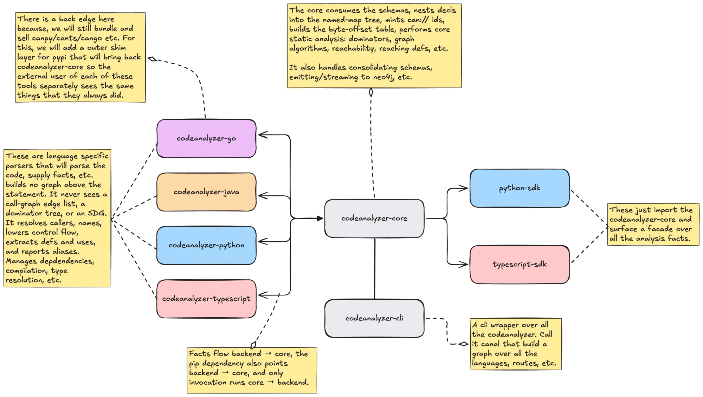

# 20: A shared Rust core with thin language backends

## 1. Summary

Today every `codeanalyzer-<lang>` is a complete pipeline. It parses one language, resolves names, builds the call graph, builds the control-flow and data-flow graphs, and builds the system dependence graph. It mints `can://` ids, computes byte offsets, caches, writes `analysis.json`, projects to Neo4j, and ships its own CLI. Five repositories in four host languages do all of that independently. Only the first two steps need the language.

This ADR splits the work. A **backend** keeps the language-specific half. It parses, resolves names and callees, lowers control flow, extracts definitions and uses, reports points-to facts, and materializes dependencies. It emits a flat stream of **facts**. One shared **core** does everything else once. The core is the `codeanalyzer` repository, written in Rust. It handles ids, offsets, levels, dominance, reaching definitions, summaries, SDG, artifacts, cache, sharding, streaming emitters, Neo4j, and schema validation. The SDKs bind to the core directly. `python-sdk` binds through PyO3, and `typescript-sdk` binds through napi-rs. A Go SDK, if someone builds one, binds through cgo or uniffi. A planned `rust-sdk` binds through the crate itself.

Canonical schema v2 and the CLI contract do not change. Backends keep their names, PyPI packages, `canpy`, `canjv`, `cants`, and `cango` commands, and current major versions. Their output stays the same, byte for byte, on every existing field. Section 8 adds one optional field.




Editable source: <https://canvs.io/app?gdrive=1ZE3opKcElNuGB4rHknU1qFdJ_9LLjmcK>

## 2. Context

### 2.1 What exists on 2026-10-13

| Backend | Host | Source LOC | Released | Schema line | In an SDK | PR CI | Engines |
| --- | --- | --- | --- | --- | --- | --- | --- |
| `codeanalyzer-python` | Python | 14.5k + 1.9k vendored Scalpel | v1.6.1 | v2.0.0, the reference implementation per the org roadmap | yes | no | Jedi, stdlib `ast`, defuse linker, Scalpel, Ray |
| `codeanalyzer-typescript` | TypeScript on Bun | 12.5k | v1.6.4 | v2.0.0 | yes | yes | ts-morph, defuse linker, custom dataflow |
| `codeanalyzer-java` | Java | 20.8k | v3.3.4 | v2 default, v1 still shipped | yes | no | JavaParser, WALA RTA, JavaParser-AST CFG |
| `codeanalyzer-go` | Go | 5.1k | v0.1.0-rc.1 | v2, L1 and L2 | no | yes | `go/packages`, `go/types` |
| `codeanalyzer-iac` | Go | 10.9k | v0.1.0 | own normative v2 contract | no | yes | Helm SDK, go-yaml, jsonschema |
| `codeanalyzer-clang` | Python | 3.3k | none | neither v1 nor v2 | no | no | libclang |
| `codeanalyzer-rust` | Rust | 1.2k | none | none. No parser, no tests | no | no | none |
| `codeanalyzer-kotlin`, `-swift` | | 0 | | | | | empty repositories |
| `codeanalyzer-schema` | | 0.8k | | v1 snapshots for java, python, typescript. v2 only for IaC. `feat/v2-schema` unmerged | | | `check.py`, `check_iac.py` |

The backends are supposed to share one contract, `canonical-schema.md` in the `cldk-devtools` plugin. It describes one additive tree, two projections, four levels, and `can://` ids. It is 398 lines of prose. The schema repository records what analyzers emit, and release-time pull requests refresh it. One backend out of five implements the accepted schema-uptake spec for that refresh. No language has a machine-readable v2 schema on `main`.

### 2.2 The problem is not the contract

The org roadmap (`.github/docs/design/roadmap.md`, 2026-08-07) already states it: "The contract is not the gap. The gap is that every analyzer implements it differently, and each one's conformance test checks it against its own declared schema rather than against the canonical one." The surveys behind this ADR confirm that finding and add the mechanism. Each host language implements every cross-cutting concern on its own. The copies share no code, and each copy has its own bugs.

| Concern | Copies | Evidence of drift |
| --- | --- | --- |
| `can://` id minting | 5 | the grammar itself differs. The keystone says `can://<lang>/<app>/…`. Python, TypeScript, and Java emit `can://<app>/<lang>/…`. Go emits `can://go/<app>/…`. Go ids cannot be split positionally. In clang, ids collide on static C functions in different files. The body-node id rule is re-implemented three times inside Java alone |
| Byte-offset tables | 4 | Python and Java both re-split the whole file on every span (a Java measurement found 23.5 GB of redundant work on commons-lang). Go emits line-granular spans. TypeScript emits UTF-16 offsets |
| Neo4j rows, Cypher escaping, Bolt writer | 5 | the same `RowBuilder`, copied by hand, with `J_`, `PY_`, `TS_`, `GO_`, `CLANG_` names hard-coded. One projection anchors the application root on `id`, and two anchor it on `name` |
| CFG, dominance, reaching definitions, SCC summaries, SDG | 3 | Python `dataflow/`, TypeScript `dataflow/`, and Java `SummaryPass`, `SdgVertices`, `SdgPortEdges` are the same algorithms written three times. Java's L4 is already engine-free. It derives from the emitted tree |
| Cache | 5 | a single monolithic file in every backend. In clang it is level-unaware. In Go it is write-only. Four backends write it inside the analyzed project, which produced the self-ingestion bug class in TypeScript and Java |
| Release gate that never fails | 5 | the same bug, `continue-on-error` followed by `steps.test.conclusion`, in python, typescript, java, go, and clang |
| Pass registry with zero passes | 2 | Go and clang carry an `analysis/` registry and a `frameworks/` package with no registered passes and no callers. Both copied the prescribed skeleton as dead scaffolding |
| Schema mirror models | 4 | hand-written Pydantic mirrors for Java and TypeScript in the SDK, and hand-written wire types in TypeScript and Go. The SDK set `extra="ignore"` and lost drift detection |
| Duplicate-declaration handling | 2 | the Java SDK backend raises. The TypeScript backend silently shadows. Changing the shared ABC touches 44 definitions in 10 files |

Four of the seven non-empty backends run no tests on pull requests. The devtools skill names the Python backend "the model to replicate." It has five files over 800 lines and eight copies of the same tree walk. It implements levels as inline `if` blocks in a 236-line `analyze()`. It mutates a tree in place, and that tree is also the cache. `codeanalyzer-iac` is the exception, and a good one. The schema repository owns its contract. Every emit validates itself. Phase results are immutable keyed deltas applied in sorted order. A conflicting fact is a runtime error.

### 2.3 Cost of change today

Adding `application.name`, one optional string, needed five units across four repositories and two phases, first optional, then required. The `heap_flow` edge family touches the keystone, three backends, and the SDK. The manifest-derived module segment spec notes that "all analyzers move together or the language-neutral merge targets stop lining up." Under the parity clause, every spine change touches N repositories, and N is growing.

### 2.4 Scaling evidence

| Workload | Measurement | Source |
| --- | --- | --- |
| vscode, TypeScript, 18,391 files | 18.1 GB at `-a 1`, 24.3 GB at `-a 2`, killed at 28 to 32 GB at `-a 4`. The 1.03 GB `analysis.json` was built as a single `JSON.stringify` string | the TypeScript backend's vscode measurements |
| commons-lang, Java, 625 files | 148 s at L1, 155 s at L2, 142 MB and 202 MB payloads. Output materialized three to four times | the Java backend's commons-lang measurements and repo notes |
| Odoo 20.0, Python, 6,685 modules | 42.6 GB at L4 before release 1.6.0, 5.7 GB after. 65.1 GB to 5.5 GB for `--emit neo4j` | the Python backend's 1.6.0 and 1.6.1 release notes |

The Python fix changed representation and lifetime. It used slotted leaf records, streamed serialization by marker splicing inside a serialized envelope, early release of ASTs through `gc.collect()`, and Ray hygiene. The fix leaves 39 `LOW-MEM PATCH` comments across 14 files. It required dropping Python 3.9 and 3.10. It removed `.model_copy()` from leaf types, which broke the SDK because the SDK imports the backend in-process. TypeScript and Java still have the same three memory sinks: a resident output tree, a single-string emit, and retained intermediates. Each would need its own 1.6.0-style fix.

## 3. Decision drivers

1. One implementation of each cross-cutting concern, so a bug is fixed once and a spine change lands once.
2. The output contract, canonical schema v2 and the CLI contract, stays fixed. Consumers see no break.
3. Backends keep their identity: repository, package name, command, current major version, and byte-identical output.
4. Memory and run time are bounded by the largest shard, not the repository, for everything outside the language engines.
5. Native engines stay. WALA runs on a JVM, `tsc` on Node, Jedi on CPython. "Depth over breadth" is the roadmap's deliberate bet and this ADR keeps it.
6. A working TypeScript SDK and a cheaper path to further SDKs.
7. New languages cost an adapter, not a pipeline.

## 4. Options considered

### Option A: conformance kit only

Keep every backend as a full pipeline. Make `codeanalyzer-schema` normative with a JSON Schema and a semantic checker. Add a shared fixture corpus and reusable CI workflows. Generate the SDK models from the schema. The org's open work on v2 consistency, a projection-parity gate, and a shared conformance suite already asks for this.

It detects drift. It does not remove the five copies, and the next language adds a sixth. Every backend still needs its own memory fix. It is the fallback if Option B's spike fails. Most of it is a subset of Option B.

### Option B: shared core and thin language backends (chosen)

The compiler shape. Backends emit facts, one core builds the graph, and SDKs bind to the core. Sections 5 to 9 describe it.

### Option C: monorepo

Move backends, schema, core, and devtools into one repository with one CI matrix. The parity clause is the textbook monorepo argument. The cost is a polyglot build and release story across five toolchains, plus an org-level reorganization. This ADR takes the part of Option C that pays: the shared pieces live together in the `codeanalyzer` repository. It leaves the backends where their toolchains and owners are.

### Host language for the core

Rust and Go were both viable. The org already has two Go backends and a proven path for shipping static binaries through PyPI. This ADR chooses Rust because one crate compiles to the engine binary, a Python extension module through PyO3, and a Node addon through napi-rs. That gives the Python SDK an in-process path. It also gives the TypeScript SDK the whole engine for the cost of a binding. Today that SDK vendors a 30 MB Java JAR and cannot parse v2 output. Rust also gives a compact graph representation and deterministic deallocation, and section 7 relies on both. The cost is a Rust codebase and the skills to maintain it. That cost is the largest risk in section 12. The vscode numbers rule out Python for the core.

## 5. Decision: logical architecture

### 5.1 Three tiers, one-way dependencies

The tiers are the **backends**, the **core**, and the **SDKs**. The core is the `codeanalyzer` repository and component. `codeanalyzer-core` is only its distribution name on PyPI and crates.io, where plain `codeanalyzer` is taken.

```
codeanalyzer-python, -java, -typescript (TS and JS), -go, -clang   BACKENDS
    parse one language, resolve names and callees,         emit facts
    lower control flow, extract defs and uses,
    report points-to facts, materialize dependencies
                        │  facts stream
                        ▼
codeanalyzer (the core, Rust)                             CORE
    ids, offsets, levels, dominance, DDG, summaries,
    SDG, artifacts, cache, shards, validation,
    streaming JSON, Cypher, Bolt
                        │  PyO3 / napi-rs / the crate; analysis.json for everyone else
                        ▼
python-sdk, typescript-sdk, rust-sdk (planned), canal     SDKs and CLI
```

A tier knows nothing about the tier above it. A backend cannot tell whether `canal` or an SDK invoked it. The core cannot tell which backend produced a fact.

### 5.2 Two contracts, both machine-checked, both owned here

**The facts IR** is the backend-to-core contract. `21-facts-ir.md` specifies it. The IR is flat typed records, one record type per kind, with no nesting, no levels, no projections, and no `can://`. A record references a declaration by a structured local key, `{file, path, sig}`. It references a statement by its callable and a local key. Spans are byte offsets. The core derives lines and columns. A backend declares the IR version it speaks in the stream header. The core refuses a mismatch with a named error. One schema file enforces the IR at both ends. Each backend's writer and the core's reader are generated from that file. The writer rejects a malformed record before it serializes the record. The core validates every record again on read. It also runs the ordering, reference, and invariant checks that no type system can state (ADR 21 §4.14).

This ADR does not list the record kinds. Step 0 of the migration derives them, once. The derivation lists every field the three v2 backends emit today in `py_schema.py`, `schema.ts`, and the `schema/J*` classes. It takes the union. It then defines the smallest set of flat record kinds that carries the union. The result is the IR schema in `codeanalyzer/schema/facts/`, which grows additively under the IR version integer. The stream below illustrates the shape. It does not illustrate the kind list.

This stream is illustrative. `canal facts dump` renders it as JSON. The wire format is MessagePack (ADR 21 §3.1). Spans are byte offsets only (ADR 21 §3.5):

```jsonl
{"t":"file","path":"src/util.go","sha256":"…","role":"source","text":"package util\n…"}
{"t":"decl","file":"src/util.go","path":[],"kind":"struct","name":"Hasher","sig":"Hasher","span":[0,400]}
{"t":"decl","file":"src/util.go","path":["Hasher"],"kind":"method","name":"Hash","sig":"Hash(string)uint64","params":[…],"span":[42,180]}
{"t":"stmt","callable":{"file":"src/util.go","path":["Hasher"],"sig":"Hash(string)uint64"},"loc":"15:2","kind":"statement","span":[84,100],"defs":["h"],"uses":["s"]}
{"t":"stmt","callable":{…},"loc":"16:2","kind":"call","span":[101,130],"defs":["h"],"uses":["h","s"]}
{"t":"call","site":{"callable":{…},"loc":"16:2"},"callee":{"file":"src/fnv.go","path":[],"sig":"New64()"},"prov":["resolver"],"method_name":"New64","args":[{"expr":"s"}]}
{"t":"cfg","callable":{…},"src":"15:2","dst":"16:2","kind":"fallthrough"}
{"t":"pts","callable":{…},"var":"p","objects":["class:3"],"prov":["points-to"]}
```

**Where source text lives, since slicing depends on it.** The `file` record carries the whole file text once, in `text`. The core stores the text on the module node, exactly where canonical v2 puts `module.source`. Every slice the SDKs perform, `get_method_body` included, is `module.source[span.bytes]`. Backends emit byte offsets from their own parser. The core builds the line table from the same text. After a backend sends the `file` record, neither side re-reads the disk. The output therefore never depends on files changing under the run. The pipeline holds no other copy of the text.

**Canonical schema v2** is the core-to-consumer contract. This ADR does not change it. The contract moves from prose in a plugin to a JSON Schema plus a semantic checker in `schema/` in the `codeanalyzer` repository. Every emit validates against the schema before the file is closed, as `codeanalyzer-iac` does today. `codeanalyzer-schema` is obsolete under this decision. Its content folds into `codeanalyzer/schema/`, and the repository is archived. Today the `cldk-devtools` skills restate the contract in prose (`canonical-schema.md`, `analyzer-architecture.md`, `cli-contract.md`, `neo4j-projection.md`, `testing-and-validation.md`). The migration rewrites them to point at `codeanalyzer/schema/` and the conformance kit, and to describe the facts IR for backend authors. This is a tracked work item in the migration. It is not an afterthought.

### 5.3 The boundary, as a rule

A backend answers "what does this statement define, use, call, and flow to next" for its language. Once those facts exist, the core answers every question whose answer is the same for all languages. If a proposed core pass needs an AST, it belongs in a backend. If a proposed backend feature produces a graph, it belongs in the core.

Applied to `codeanalyzer-python`, stage by stage:

| Stage | Today, all in Python | Backend emits | Core does |
| --- | --- | --- | --- |
| Materialize | venv plus `uv` install | same | nothing |
| Symbol table, L1 | `SymbolTableBuilder`, one `PyModule` per file held for all files | `file` and `decl` records with Jedi-resolved types, decorators, imports | nests decls into the named-map tree, mints ids, builds the byte-offset table |
| Call sites, L1 body | stored on callables, converted later | `stmt` records of kind `call` with Jedi's candidate callee | places them in `body`, `callee` null until L2 |
| Call graph, L2 | `jedi_call_graph_edges`, defuse linker tiers T1 to T5, `merge_edges`, `backfill_callees` | each resolved call with a callee reference and `prov`. Resolution stays in Python | dedupe per `(src, dst)`, `prov` union, weight, external homing, `callee` backfill, application-level `call_graph` |
| CFG, L3 | `dataflow/cfg.py` lowers if, for, try, with, yield, await, match | `stmt` records for every statement, `cfg` edge records. This stays in the backend. Lowering is language knowledge | validates single entry and exit, reachability |
| Def and use, L3 | `access_paths.py` | `defs` and `uses` on each `stmt` | nothing |
| CDG, L3 | dominance code | nothing | post-dominators, control dependence |
| DDG syntactic, L3 | reaching-defs solver in `builder.py` | nothing | worklist reaching definitions, k-limited, `prov: ["ssa"]` |
| SDG, L4 | `build_program_graphs`: Tarjan SCC, summary fixpoint, port vertices | nothing | all of it. Java and TypeScript also carry the same code |
| DDG semantic, L4 | Scalpel oracle, `emit_ddg_pointsto_delta` | `pts` records with `class:` tokens | the added `ddg` edges, `prov: ["points-to"]`. The same mechanism yields `heap_flow` |
| Entrypoints | `detect_entrypoints` over `rules.yml` | decorators and base classes are already in `decl` records | the shared rules engine |
| Artifacts, config keys | parsers and `config_use.py` tiers | `artifact`, `dependency`, `config_key` records | the config-use join |
| Ids, spans, homing, cache, JSON, Neo4j | `ids.py`, `assign_ids`, three writers, `neo4j/` | nothing | all of it |

After the split, the Python backend builds no graph above the statement. It never sees a call-graph edge list, a dominator tree, or an SDG.

### 5.4 The pass model is the core's skeleton

This ADR takes the model from the Python backend's refactor proposal and generalizes it. A pass declares `name`, `scope` (application, module, callable), `min_level`, `requires`, and `provides`. The core assembles the pipeline in one place and compiles it per level into a DAG. It rejects the pipeline on a cycle or an unsatisfied requirement. A pass receives earlier results read-only and returns only additions. This enforces monotonicity across levels, `L1 ⊆ L2 ⊆ L3 ⊆ L4`, by construction. Backends do not participate in this pipeline. They run before it and feed it.

### 5.5 Invariants the core enforces at run time

- No dangling edge endpoints in any list.
- `L1 ⊆ L2 ⊆ L3 ⊆ L4`, with `callee: null → id` the only refinement.
- The core projects `analysis.json` and the Neo4j graph from one in-memory graph, so they cannot disagree.
- Output does not depend on `-j`. It uses the `codeanalyzer-iac` method: keyed immutable deltas applied in sorted order.

## 6. Decision: physical architecture

### 6.1 Repositories

No new repository. The `codeanalyzer` repository gains a Cargo workspace. It holds the `codeanalyzer-core` library crate, the `codeanalyzer-cli` binary crate, `schema/`, and `fixtures/`, the shared cross-language golden corpus. The language backends stay in their repositories and shrink. `codeanalyzer-iac` stays a sibling with its own contract. It shares the neutral `artifact` and `can://` namespaces and the Neo4j writer. Nothing forces it through the code facts IR. `cldk-devtools` keeps its skills. They point at `schema/` and the conformance kit instead of restating them, and the backend skill teaches the facts IR instead of the full pipeline. A rule that the core does not check is not a rule.

What each backend keeps and deletes, from the surveys:

| Repository | Keeps | Deletes |
| --- | --- | --- |
| `codeanalyzer-python` | `symbol_table_builder.py`, `defuse_linker.py`, `dataflow/cfg.py`, `dataflow/access_paths.py`, `scalpel/`, `scalpel_oracle.py`, venv materialization, `artifacts/parsers.py`, per-file parallelism | `dataflow/builder.py`, dominance, summaries, SDG, `neo4j/`, `py_schema.py` wire models, `ids.py`, `assign_ids`, `l1_body`, `l2_callees`, homing, cache, three JSON writers, most of `core.py` and `__main__.py`. About 9k of 14.5k lines |
| `codeanalyzer-typescript` | `builders.ts`, `symbolTable.ts`, `moduleResolution.ts`, `callGraph.ts`, `phantoms.ts`, `defuseLinker.ts`, `cfg.ts`, the def/use half of `defuse.ts`, `materialize.ts`, the worker pool | `dominance.ts`, `summaries.ts`, `sdg.ts`, `attach.ts`, most of `dataflow/index.ts`, `schema/emit.ts`, `assignIds`, `l1Body`, `l2Callees`, `schema.ts`, `ids.ts`, `build/neo4j/`, `serialize.ts`, `cache.ts`, the half-built `--emit-ir` sharding. About 7k of 12.5k |
| `codeanalyzer-java` | `L1Extractor`, `ModuleBuilder`, `TypeBuilder`, `CallableBuilder`, `CallSiteBuilder`, `Signatures`, `BuildProject`, `WalaAnalysis`, `RtaCallGraph`, `ScopeUtils`, `CfgBuilder`, `WalaCfgBuilder`, `WalaPdgBuilder` as a points-to fact producer, `javaee/` finders, `ManifestParsers`, `ConfigKeys`, `ConfigUses`, `ViewDispatches` as fact producers | `DdgBuilder`, `CdgBuilder`, `SdgVertices`, `SummaryPass`, `SdgPortEdges`, `Scc`, `V2Emitter`, `V2Json`, `L1Cache`, `CanId`, `Spans`, the 38 `schema/J*` POJOs, `neo4j/`, most of `CodeAnalyzer.java`. About 12k of 20.8k. The v1 path stays, deprecated, see section 8 |
| `codeanalyzer-go` | `symbol_table.go`, `call_graph.go` | v1 structs, `v2emit`, `neo4j/`, cache, empty registries. About 3.5k of 5.1k |
| `codeanalyzer-clang` | `clang_loader.py`, `symbol_table_builder.py`, `signatures.py`, `call_graph.py` | everything else, which was a copy of Python's older skeleton. About 2.3k of 3.3k |
| `codeanalyzer-rust`, `-kotlin`, `-swift` | nothing to migrate | written as backends from the start |

### 6.2 Processes at run time

**Repositories with more than one language, and modules.** The engine knows only which languages are present in a repository. It looks for the root manifests it can recognize (`pom.xml`, `build.gradle`, `pyproject.toml`, `package.json`, `go.mod`, `compile_commands.json`) only to decide which backends to start. `--lang` restricts that choice. The engine does not decide which file belongs to what.

A **module** is a build unit that the ecosystem declares. Examples are a Maven or Gradle module, a Cargo workspace member, a Go module, an npm workspace package, and a Python distribution. For every file it analyzed, each backend reports the one build unit that owns the file. The backend takes ownership from the build system itself. Maven and Gradle use each module's declared source roots. Cargo uses `cargo metadata`. Go uses `go list`. npm uses each workspace package's `package.json`. Python uses the distribution's wheel `RECORD` (see `codeanalyzer-python/0001`). The engine computes no ownership and matches no paths. It records what the backend reports. It raises a diagnostic for a file that two units report. It leaves a file that no unit reports unclaimed. The engine still analyzes that file, with no module. The manifest-derived segment spec puts this module into the id. So two units that declare the same fully-qualified name cannot collide. That collision is a known Java defect.

The output is one application with per-language, per-module nodes, whether or not the languages are related. A monorepo of a TypeScript frontend and a Python service looks the same to the engine as a monorepo of three unrelated tools. Cross-language edges, for related languages, belong to the roadmap's cross-language initiative. They are out of scope here. This ADR only guarantees that ids and the graph are ready for them. Groupings finer than the build unit, such as an Odoo addon or a Django app, are a consumer-side filter on paths. They are not a schema concept.

A run uses one engine process and one backend process per language present in the input. The engine spawns the backend with `--facts -i <root> -a <level> --cache-dir <dir>`. It reads the MessagePack facts stream from the backend's stdout (ADR 21). It reads diagnostics as records in that stream, and it reads anything else from stderr. It treats the exit code per the existing CLI contract. The engine finds a backend in this order: the `CAN_BACKEND_<LANG>` environment variable, `can-backend-<lang>` on `PATH`, the pip shim's `command()`. A language that the engine detects but that has no installed backend produces a diagnostic that names the package to install. Under `--strict`, it also produces a non-zero exit. Only a backend written in Rust could link in-process. Today none is.

The backends' runtimes stay as they are: a JVM for Java, Bun for TypeScript, CPython for Python and clang, and the `go` toolchain for Go. The toolchain requirements that users have today also stay. Java at `-a 2` and above needs a JDK plus Maven or Gradle. TypeScript materialization needs `npm`. Go needs `go`. The core is one static binary with no requirements. The improvement is that the check runs once. `canal doctor` reports, per installed backend, what is present and which levels the backend can reach. A backend declares its reachable `max_level`, so the core never silently runs less than asked.

### 6.3 Parallelism

Backends own per-file parallelism in whatever form their runtime offers. That parallelism has to use worker processes, not threads. Three reasons, and a repository has already paid for each. First, Bun workers are threads in one process. Each worker gets its own heap, but the process RSS is unbounded. The TypeScript vscode measurements record `-j 4` dying at 29 GB. Second, CPython threads serialize on the interpreter lock, so the Python backend uses Ray. Third, a crash in one worker, such as a Jedi recursion or a WALA OOM, takes down only that shard. The facts protocol makes processes free. Each worker writes its own facts, and nothing needs to be marshalled back into a parent. Backends write facts per shard. The engine unions shards by `can://` id. Engine-side L3 passes are per-callable and run across threads. `-j` is one flag. The engine reads it and passes it through. Output is byte-identical across `-j` by construction.

### 6.4 Packaging

The `codeanalyzer-cli` crate builds the engine binary once, and the binary ships two ways. A backend install never puts `canal` on `PATH`.

| Package | Contains | Puts on `PATH` | Depended on by |
| --- | --- | --- | --- |
| `codeanalyzer-core` (PyPI, platform wheels) | the PyO3 module and the `canal` binary under `_bin/` with `bin_path()` | nothing | every backend, `cldk`, `codeanalyzer-cli` |
| `codeanalyzer-python`, `-java`, `-typescript`, `-go`, `-clang` | as today, plus `Requires-Dist: codeanalyzer-core` | `canpy`, `canjv`, `cants`, `cango`, `canclang`, each an alias that execs the hidden binary with `analyze --lang <x>` | users, `cldk` extras |
| `codeanalyzer-cli` (PyPI, platform wheels; Homebrew; GitHub release) | the same binary with the `canal` console script, `canal doctor`, completions. No backend by itself. Extras pull backends: `codeanalyzer-cli[python]`, `[java]`, `[typescript]`, `[go]`, `[all]`. The Homebrew formula takes the same options | `canal` | users who want one command over every language |
| `@codellm-devkit/core` (npm) | the napi-rs addon | nothing | `typescript-sdk` |
| `codeanalyzer-core` (crates.io) | the library crate, reserved | | third parties embedding from Rust |

A user who runs `pip install codeanalyzer-cli` with no extra gets `canal` and the engine, and nothing that can parse a language. `canal doctor` lists the languages it could serve and the package each needs. `canal analyze` on a Java tree says "no backend installed for java: `pip install codeanalyzer-cli[java]`" and exits non-zero. `pip install codeanalyzer-cli[all]` is the one-line install for a user who wants everything. A user who runs `pip install codeanalyzer-python` gets `canpy` and nothing else, as today. `canpy -i ./proj -a 4 --emit neo4j` behaves exactly as it does now. The org already has a precedent: `jdk4py` ships a whole JVM inside `codeanalyzer-java` and never puts `java` on `PATH`. Homebrew mirrors the pip graph. The core formula installs to `libexec`, backend formulas depend on it, and only the `codeanalyzer-cli` formula links `canal` into `bin`.

Name availability was checked on 2026-10-13. `codeanalyzer`, `canal`, and `can` are taken on PyPI. `canal`, `can`, and `can-core` are taken on crates.io by unrelated projects. `codeanalyzer-core` and `codeanalyzer-cli` are free on both.

### 6.5 Cache

The cache has one location, `$XDG_CACHE_HOME/codeanalyzer/<app-hash>/`, never inside the analyzed project. Backends write materialization caches under `<app-hash>/backend/<lang>/`. The engine writes its sharded graph cache beside them. This closes the self-ingestion bug class by construction.

### 6.6 CI

On every pull request, the `codeanalyzer` repository runs schema validation, monotonicity, projection parity, no-dangling, and `-j` determinism checks. It also runs a real-world corpus with a memory and wall-clock budget. Each backend repository runs a reusable workflow from `.github`. The workflow validates the backend's facts against the IR schema, passes them through a pinned engine, and compares the result with recorded goldens. Pull-request CI becomes mandatory in every repository. The release gate uses `steps.<id>.outcome`, not `conclusion`.

## 7. Decision: implementation standard

This section is the project-wide standard the ADR title refers to. It binds the core and every backend, each in its own language.

- **The pass model is the only way analysis runs** (section 5.4). The registry is constructor-injected and immutable. It is never a package-level list filled at import time. No one scaffolds a registry with zero passes "for later."
- **Facts records are generated, never hand-written, and checked twice.** The IR schema in the `codeanalyzer` repository is the source. Codegen produces the Python dataclasses, TypeScript types, Java records, and Go structs that each backend's facts writer uses. It also produces the Rust structs that the core deserializes into. A backend cannot misspell a field, and the core does not trust that it did not. The core validates every record on read. It then checks ordering, resolvable references, and semantic invariants (ADR 21 §4.14). Downstream, the SDK's Pydantic and Zod models are generated from canonical v2. `extra="ignore"` goes away, so drift fails a test again.
- **Graph representation in the core.** The core uses arena allocation with integer handles, interned strings, and edges as flat vectors. The graph is immutable after a pass returns. No single tree serves as the working set, the cache, and the output.
- **Determinism is a build rule, not a test.** Phase results are keyed immutable deltas applied in sorted order. Every collection is sorted at the boundary. No emitted field depends on the machine: no absolute paths, no mtimes, no interpreter version. Output is byte-identical across `-j`, across runs, and across hosts.
- **Emission.** One pure projection from the graph to rows feeds the JSON writer, the Cypher writer, and the Bolt writer. All three stream. The core validates every document against the schema before it closes the file. The projector reads the Neo4j catalog as its allowlist. It does not read a parallel hand-maintained list.
- **Errors and channels.** stdout carries data only. stderr carries structured diagnostics. A per-file failure is a recorded diagnostic in the output. It is never a swallowed exception and never a silent exit 0. `--strict` turns diagnostics into a non-zero exit. A missing toolchain halts with install instructions. A failed dependency install degrades and records the failure in the envelope.
- **Hygiene, enforced by lint where possible.** No static mutable state. No orchestrator that inlines analysis. Files over roughly 500 lines need a reason in review. One source for each version string.

### 7.1 Memory, estimated on the 1.6.0 workload

Full Odoo 20.0, level 4, eight workers. The 1.6.1 column uses the 1.6.0 and 1.6.1 release measurements where they exist. The ADR column is a sizing estimate from record sizes. It is not a measurement. Step 0 of the migration replaces it with one.

| Phase | 1.6.1 | ADR: Python backend | ADR: Rust core |
| --- | --- | --- | --- |
| L1 symbol table | 5.9 GB peak: driver accumulates every `PyModule`, 8 Ray workers, 1 GB object store | 2.0 to 3.5 GB: Jedi per worker unchanged at 0.3 to 0.4 GB, no driver accumulation, no object store | 0.1 GB |
| L2 call graph | about 4 GB, whole tree resident | 0.3 to 0.8 GB, the linker's name index | 0.1 GB |
| L3 | 4 to 5 GB, per-function PDGs and two AST copies | per-file working set, about 0.5 GB per worker | 0.2 GB transient. DDG edges stream and are not resident |
| L4 | about 5 GB | 0 | 0.5 to 1.0 GB |
| Emit JSON | within 5.7 GB, streamed by marker splicing | 0 | 0.05 GB |
| Cache save | 0.87 GB allocation peak | 0 | 0.01 GB, sharded per module |
| Emit Neo4j | 5.06 GB emit peak | 0 | 0.1 GB |
| Whole run | 5.7 GB JSON, 5.5 GB Neo4j | 2.5 to 4.5 GB at `-j 8`, about 2 GB at `-j 1` | |
| **Total estimate, peak of the whole process tree** | **5.7 GB** | **3.5 GB at `-j 8`** (Jedi workers 2.5 GB, plus the core's 1.0 GB resident at L4. The two overlap in time) | **1.6× lower. About 2 GB and 2.8× lower at `-j 1`** |

The estimate assumes these record sizes. A declaration node is about 100 B with interned strings. A body node is 48 B. A CFG or CDG edge is 9 B. A DDG or call edge is 12 to 16 B. A port vertex is 24 B. An index entry is 40 B. Allocator overhead is 1.5 to 2×. The estimate also assumes a statement count of 1.5M and a DDG count of about 37M, scaled from the pilot's 1.75M for 315 modules.

The whole-run peak improves 1.5× to 3×, not 7×. After 1.6.0, the ceiling is Jedi, and this ADR does not change Jedi. The core's own footprint sits about 5× below the 1.6.1 driver's post-L1 phases. It stops growing with the project once DDG edges stream. The same core column applies unchanged to TypeScript and Java. Their engine peaks, 21 GB inside `tsc` on vscode and 4 GB inside WALA, also stay where they are. Only sharding the backend run bounds them, and the facts protocol makes sharding possible.

## 8. Decision: versioning

Byte-identical output means the schema does not move. Package versions move as minors, and every current major line stays.

| Line | Owner | What moves it | On the first core release |
| --- | --- | --- | --- |
| Schema | `schema/` in `codeanalyzer` | a change to what `analysis.json` or the graph contains | stays `2.0.0`. One additive optional field, below |
| Facts IR | the core, a single integer | a change to the record shapes | `1`. The core accepts `N` and `N-1` |
| `codeanalyzer-core` | the `codeanalyzer` repository, semver | major when the IR or schema goes major | `0.x` until the first backend ships on it, then `1.0.0` |
| each backend | its repository, semver | its own CLI and in-process API | a minor each, see below |
| `cldk` | its repository | its public API | stays on the 2.x line |

Three commitments make the backend minors honest:

1. **Every existing flag keeps working.** The `can*` commands accept today's flags and translate them. Unusual flags become aliases with a deprecation warning on stderr. TypeScript's `--emit-ir` becomes `--emit facts`. `--program` and `--list-programs` become the core's sharding. Java's `--schema v1`, `-s`, and `-t` keep running the existing v1 code path, untouched and deprecated. That path leaves with 4.0, when 4.0 comes for other reasons.
2. **The envelope keeps the backend's identity.** `analyzer: {name: "codeanalyzer-python", version: "1.7.0"}` stays exactly as it is, because the user installed and invoked that tool. The envelope records the core additively as `core: {version, ir}`. Existing fields are byte-identical, with nothing normalized. The SDK's `analyzer.version == backend-versions[...]` assertion keeps passing. `2.0.0` holds under the rule the `application.name` spec used.
3. **Python's in-process API stays as a deprecated facade.** `Codeanalyzer(AnalysisOptions(...)).analyze()` keeps returning an `Analysis` object with the same attribute surface. It runs the hidden core and loads the result through the generated models. The facade lives for at least one minor cycle after the SDK stops importing it.

| Backend | Today | After | Deprecated, not removed |
| --- | --- | --- | --- |
| python | 1.6.1 | 1.7.0 | in-process `Codeanalyzer` facade |
| java | 3.3.4 | 3.4.0 | `--schema v1`, `-s`, `-t` |
| typescript | 1.6.4 | 1.7.0 | `--emit-ir`, `--program` spelling |
| go | 0.1.0-rc.1 | 0.2.0 | nothing |
| clang | unreleased | 0.1.0 | nothing |

**"Byte-identical" in the migration gate** means what the 1.6.0 verification meant. It means identical content on identical input, whitespace aside. It also allows an explicit, reviewed allowlist of divergences, each tied to an issue, for bugs the core will not reproduce. Known entries: Java's edge weight is always 1 because `AbstractGraphVertex.equals` is identity-based. Go collapses two `init()` functions into one edge because dedup ignores the file. TypeScript's `span.bytes` are UTF-16. Reproducing those bugs to pass a gate would be perverse.

**What goes away.** Lockstep between backends, since none reads another's output. The four-place pin and the "Incorporate vX" issues, since the SDK pins the core only. The release-time schema uptake pull requests, since the schema lives beside its enforcer. A backend release is independent as long as it stays within the IR versions the installed core accepts.

## 9. Decision: migration

Strangler pattern, lowest level first, byte-identical gate per step. The team deletes nothing until the core reproduces it. Every step ships as a minor.

| Step | What lands | Gate | Ships |
| --- | --- | --- | --- |
| 0 | the facts IR schema, derived from the union of what the three v2 backends emit. The graph representation. The JSON emitter. All in the `codeanalyzer` repository | load the recorded Odoo and commons-lang `analysis.json` files and re-emit them byte-identical. Measure the resident set and replace section 7.1 with numbers | nothing user-visible |
| 1 | `codeanalyzer-go` on the core. It is the smallest, L1 and L2 only, unreleased, with no SDK consumer. Its `v2emit` already converts a working model to wire structs | the IR, the subprocess protocol, discovery, and the hidden-binary packaging proven end to end | go 0.2.0 |
| 2 | `codeanalyzer-python` on the core, because its `dataflow/` is the specification for the core's L3 and L4 passes, ported once. The step climbs a ladder: L1 facts, then L2 callee facts. Next, CFG and def/use facts, with the core computing CDG and DDG. Last, points-to facts, with the core computing summaries and SDG. The old emitter stays behind a flag until each gate is green | byte-identical against 1.6.1 on the fixture corpus and on Odoo, per level | python 1.7.0 with the deprecated facade |
| 3 | `codeanalyzer-typescript`: declaration-merging ids, UTF-16 correction on the allowlist, worker processes replacing Bun threads | byte-identical against 1.6.4. The TypeScript backend's vscode measurements serve as the scaling gate | typescript 1.7.0 |
| 4 | `codeanalyzer-java`: facts from JavaParser, RTA edges from WALA built once, `--schema v1` untouched | `realWorldConformanceTest` corpus byte-identical against 3.3.4 | java 3.4.0 |
| 5 | `cldk` depends on `codeanalyzer-core` and binds through PyO3. It gets in-process `analyze()` and `query()`. Generated models replace the hand-written mirrors. The Neo4j `reconstruct.py` paths and the in-process Python backend import go away. The per-language pins go away | the SDK's existing facade tests pass unmodified | cldk 2.x minor |
| 6 | `typescript-sdk` binds through napi-rs. The `cldk-devtools` skills are rewritten against `codeanalyzer/schema/` and the facts IR. `codeanalyzer-schema` is archived | the TypeScript SDK parses v2 output for the first time | typescript-sdk first usable release, not urgent |
| then | clang is rebuilt as a small facts backend. Rust, kotlin, and swift are written as backends from the start. `heap_flow` and the module segment land once in the core | | |

The order protects two things. First, nothing user-visible changes until step 5, and then only the SDK's dependency list. Second, the core's L3 and L4 are validated against the reference backend before Java and TypeScript depend on them. So a porting error surfaces on the reference, not on a consumer. If step 0 cannot re-emit Odoo byte-identical within a bounded spike, the decision falls back to Option A. Its conformance kit is a subset of this plan and has value alone.

## 10. Consequences

Gains:

- One implementation of each cross-cutting concern, replacing three to five. About 34k lines across the five backends fall into the Deletes column of section 6.1.
- A spine change touches the `codeanalyzer` repository plus the backends that supply new facts. `application.name` cost five units across four repositories. `heap_flow` would cost one.
- Polyglot analysis: one `canal` run over a repository with Java and TypeScript yields one application with both.
- A TypeScript SDK that works, through the same crate. Not urgent, but it comes with the core for the cost of a binding.
- Memory in the core is bounded by the largest shard, and every backend gets an entry point for sharding.

Costs:

- A Rust codebase the team does not have today, and Rust skills to maintain it for years.
- Porting Python's dataflow once, about 3k lines, under byte-identical gates. Weeks, not days.
- The facts IR is a second contract to govern. Smaller than the schema, but real.
- A period in which each backend carries its old emitter and the facts writer side by side.
- Deprecated surfaces, the Python in-process facade and Java's v1 path, until a natural major.

## 11. Confirmation

Gates check compliance, not review alone:

- Step 0 of §9: the core re-emits the recorded Odoo and commons-lang `analysis.json` files byte-identical before any backend changes.
- Each migration step: the backend's facts, run through a pinned core, reproduce its previous output byte-identical on its fixture corpus. The reviewed allowlist in §8 is the only exception.
- Every pull request in the `codeanalyzer` repository: schema validation, monotonicity, projection parity, no dangling endpoints, and `-j` determinism. The real-world corpus run, with memory and wall-clock budgets, also applies (§6.6).
- Every pull request in a backend: facts validate against the IR schema and the goldens match (§6.6, ADR 21 §4.14).
- The SDK: its existing facade tests pass unmodified at step 5.

## 12. Risks

| Risk | Mitigation |
| --- | --- |
| Rust skills thin on the team | step 0 is a bounded spike with a measured exit. Fall back to Option A if it fails |
| the facts IR drifts the way the schema did | generated writers, version negotiation that refuses mismatches by name, the IR schema in the same repository as its consumer, `codeanalyzer` |
| the process boundary is too slow on huge repositories | measured at step 3 on vscode. The escape hatch is an in-process binding for one backend, which the IR allows without redesign |
| a porting error in the core's L3 or L4 | validated against python 1.6.1 on the reference before any other backend depends on it |
| migration stalls halfway | every step is a shippable minor. A half-migrated world still has the core, which is better than today |
| the hidden-binary packaging doubles the engine on PyPI | about 10 MB per platform, accepted so that a backend install surface stays identical to today |

## 13. Open questions for the RFC

These are the team's to decide, not this ADR's.

1. Who owns the core, and is Rust staffing committed, or is Go the fallback host language?
2. Does `codeanalyzer-iac` ever join the core, or stay a sibling permanently?
3. Where does the query layer from the SDK 2.0 design live long term: in the core as `query()`, or in the SDKs over the graph?
4. Is a Java SDK wanted? It would add a Panama or JNI binding beside PyO3 and napi-rs.
5. How long the deprecation window should be for the Python in-process facade and Java's v1 path.
6. Whether to claim the dormant `canal` name on PyPI through PEP 541. This takes months and should not block anything.

## 14. References

Org-level: `.github/docs/design/roadmap.md` (2026-08-07) and the cross-repo specs under `.github/docs/design/specs/`: canonical v2 consistency, the contract freeze from python, the projection-parity gate, the shared conformance suite, python-sdk 2.0, schema uptake on release, the manifest-derived module segment, `application.name`, and `heap_flow`.

Backends: the Python backend's refactor proposal, its 1.6.0 and 1.6.1 memory releases, and its release-gate defect; the TypeScript backend's three memory ceilings, worker packaging, UTF-16 offsets, release gate, and self-ingestion defects; the Java backend's L1 performance notes, per-callable declaration text, release gate, self-ingestion, and duplicate-FQN defects; the schema repository's application-root anchor and spine-on-main work; the SDK's duplicate-handling divergence. Issue numbers are left out on purpose: issues get closed and rewritten, and the surveys of 2026-10-13 record the state they describe.

Standard being replaced in part: `cldk-devtools/skills/designing-cldk-changes/references/canonical-schema.md`; `cldk-devtools/skills/codeanalyzer-backend/references/{analyzer-architecture,cli-contract,neo4j-projection,testing-and-validation,project-materialization}.md`.

Surveys: per-backend architectural surveys of python 1.6.0, typescript 1.6.4, java 2.4.1 and 3.3.4, go 0.1.0-rc.1, iac 0.1.0, clang, rust, the python-sdk `release/2.0` line, and the packaging and homebrew channels. All were read on 2026-10-13 and summarized in section 2.
